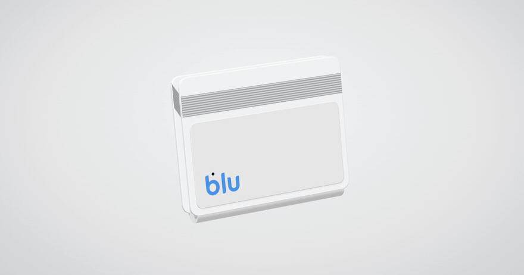

# Blu Cards Wallet — 3D animation



🎬 [Watch the full-quality video (MP4)](docs/demo.mp4) · **Live:** https://blu-bank-cards-animation.vercel.app

A 3D card wallet built with three.js. Click the wallet: it spins, opens, and fans out three Blu Junior cards. Click again to close it.


## How it moves
- One number, `progress`, goes from 0 (closed) to 1 (open). Every part — spin, flap, cards, strap, floating shapes — reads its pose from that number, so open and close are always in sync.
- While closed, the wallet floats with a slow bob and sway to invite a click. The float fades out as it opens.
- The pointer adds a light parallax tilt.
- Keyboard: focus the scene and press Enter or Space. Honours `prefers-reduced-motion`.
- The page renders only when something changes, so an idle tab costs no GPU work.

## Run locally
```bash
npm install
npm run dev
```

## Files
| File | What it holds |
|---|---|
| `src/main.js` | Scene, wallet model, animation and interaction |
| `src/textures.js` | Card sheet, logo and generated textures |
| `src/style.css` | Page layout and footer |
| `public/` | Card artwork (WebP), Ravi font, favicon |
| `docs/` | README picture, GIF and video |

## Credits
- Motion inspired by Shakuro's [3D Card Holder](https://dribbble.com/shots/27491328-3D-Card-Holder-Animation-for-Financial-Company-Branding) Dribbble shot.
- Blu logo and Blu Junior card artwork belong to Blu Bank. Ravi font by its designers. This is an unofficial design concept.
